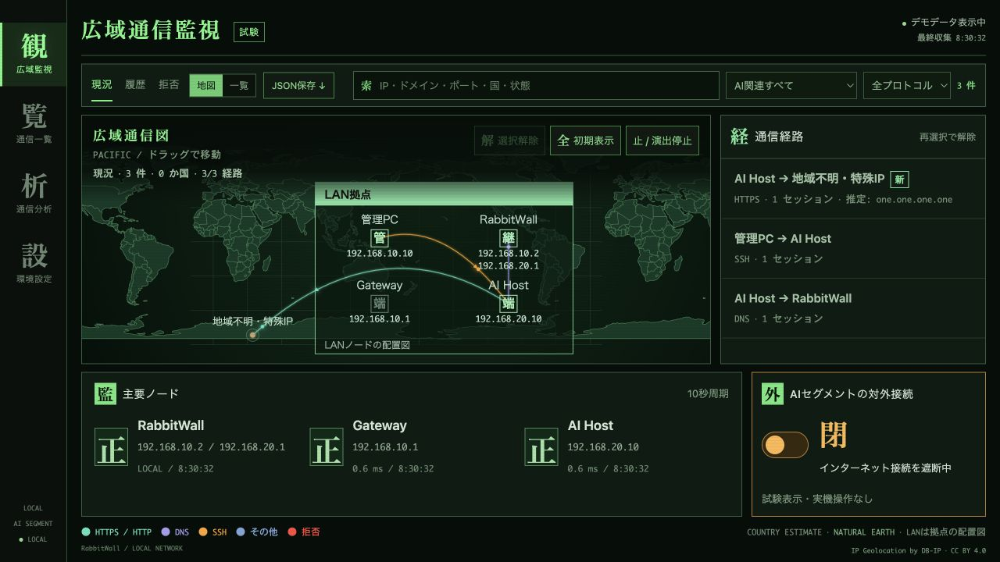
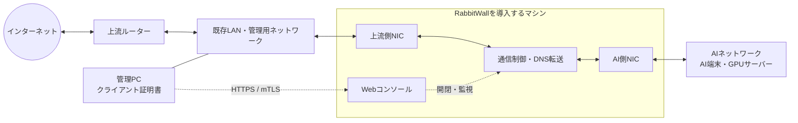

# RabbitWall

[English](README.md) | [日本語](README.ja.md)


AI用ネットワークの通信を可視化し、インターネットへの接続を手元で開閉する、Linuxゲートウェイに導入するWebコンソールです。

- 通信セッションを世界地図・経路一覧・履歴で確認
- ノードの死活監視、推定ドメイン・国・初見ドメインの表示
- 直近1時間／24時間の通信量ランキング
- インターネットの開閉。閉じると既存接続とDNSも遮断
- 管理PCのIP制限＋Caddyのクライアント証明書認証（mTLS）
- 配色変更、地図のドラッグ、読みやすい状態表示

IP・NIC・ノード名・DNS・拠点位置を **1つのJSONファイル**に設定します。管理画面へのアクセスは、管理PCのクライアント証明書で認証します。



## 利用構成

RabbitWallを、既存LANとAIネットワークの間に配置します。RabbitWallを導入するマシンには、上流側とAI側にそれぞれ有線NICが必要です。



- **実線**はネットワークの接続経路、**点線**は管理・制御の関係です。管理PCは既存LAN経由でWebコンソールへ接続します。
- AI端末はRabbitWallを**デフォルトゲートウェイとDNS**に指定し、RabbitWallが通信と名前解決を上流へ中継します。
- 開閉の対象は**AI側のインターネット接続**です。管理PCの通常通信は、既存LANから上流ルーターへ流れます。
- 上流側とAI側は別のサブネットにします。標準のNAT方式では、AI側の通信はRabbitWallの上流側IPから送信されます。

DNS転送はUnbound、推定ドメインの収集は独立したdnstap観測サービスが担当します。観測停止中もDNSは継続し、「閉」ではキャッシュ応答も遮断します。

## まず画面を試す

Python 3.11以上で、OS設定を変えずにデモを起動できます。macOSでも動作します。

```sh
python3 setup.py demo
```

ブラウザーで `http://127.0.0.1:8766` を開いてください。表示・開閉操作とも模擬データです。

## 導入

対象は **Debian 13以上 / Ubuntu 24.04系、systemd、NetworkManager、有線NIC 2つを備えたマシン**。アプリとFirewallの仮想ネットワーク試験はLinuxコンテナで実施しています。NICのドライバー・NetworkManagerによる実機の接続切り替えは導入先で確認してください。

Debian 12以前は対象外です。標準のdnspythonが必要バージョン（2.6.1以上・3未満）を満たさないため、Debian 13以上を使用してください。

1. [導入手順](docs/INSTALL.ja.md)に従い、依存パッケージとRabbitWallを導入するマシンを準備
2. 設定を作り、適用計画を生成
3. ローカルコンソールから適用し、管理PCへ証明書を登録

```sh
python3 setup.py init
python3 setup.py plan
sudo python3 setup.py check
sudo python3 setup.py install --apply-network
```

初回適用はRabbitWallを導入するマシンのFWと両NICの設定を変更します。上記だけで完了するものではなく、前提条件・AI端末の固定IP・mTLS登録を含む [導入手順](docs/INSTALL.ja.md) を確認してください。通常のPCやDockerホストへの上書き導入は対象外です。

標準はNAT方式で、上流ルーターへの静的経路追加は不要です。経路方式も選べます。導入・再起動・制御サービス再起動の直後は **閉** になります。DHCPサーバーは提供しません。

## 保守

- [設定・更新・復旧](docs/INSTALL.ja.md)
- [日常運用・DNS・通信量の見方](docs/OPERATIONS.ja.md)
- [セキュリティ上の範囲と報告方法](SECURITY.md)
- [プログラムのフロー・関数と依存先の関係](docs/PROGRAM_FLOW.ja.md)
- [開発と試験](CONTRIBUTING.md)

本体はMITライセンス。地図データ等の第三者資材については [THIRD_PARTY.md](src/rabbitwall/static/THIRD_PARTY.md) を参照してください。国別IPデータは任意の追加導入です。

フォルダー構成：アプリ本体は `src/rabbitwall/`、導入・保守処理は `tools/`、サービス定義は `systemd/`、テストは `tests/` です。
