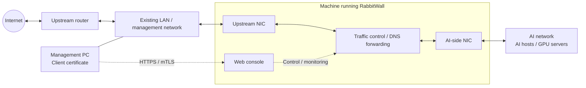

# RabbitWall

[English](README.md) | [日本語](README.ja.md)


RabbitWall is a web console for a Linux gateway that lets you observe traffic from an AI network and switch its Internet access on or off.

- View connection sessions on a world map, in a route list, or in session history
- Monitor node availability and display inferred domains, estimated countries, and newly observed domains
- Rank traffic volume over the last hour or 24 hours
- Close Internet access, including established connections and DNS
- Restrict management access to one PC using source-IP filtering and Caddy client-certificate authentication (mTLS)
- Choose a color scheme, drag the map, and check clearly labeled status indicators

Configure IP addresses, network interfaces, initial nodes, upstream DNS, and the site's map location in **one JSON file**. After installation, manage nodes and management-access permissions from Settings. The management PC authenticates with a client certificate.


## Network layout

Place RabbitWall between your existing LAN and the AI network. The machine running RabbitWall needs two wired network interfaces: one upstream and one facing the AI network.



- **Solid lines** show network connections; **dotted arrows** show management and control relationships. The management PC reaches the web console through the existing LAN.
- AI hosts use RabbitWall as their **default gateway and DNS server**. RabbitWall forwards their traffic and DNS queries upstream.
- The switch controls **Internet access for the AI network**. The management PC's ordinary traffic goes directly through the existing LAN to the upstream router.
- Use separate subnets for the upstream and AI interfaces. With the default NAT mode, AI traffic leaves through RabbitWall's upstream IP address.

DNS forwarding uses Unbound; a separate dnstap observer supplies inferred domains. Observer downtime does not stop DNS, and closing the gate blocks cached DNS answers too.

## Try the demo

Run the demo with Python 3.11 or later without changing your operating system settings. It also runs on macOS.

```sh
python3 setup.py demo
```

Open `http://127.0.0.1:8766` in your browser. Both the displayed traffic and the Internet-access switch are simulated.

## Installation

The target environment is **Debian 13 or later, or Ubuntu 24.04, with systemd, NetworkManager, and two wired network interfaces**. Application and firewall tests run in Linux containers with virtual networks. Verify hardware drivers and NetworkManager connection changes on the machine where you install RabbitWall.

Debian 12 and earlier are not supported: their standard dnspython package does not meet the required version (>=2.6.1,<3). Use Debian 13 or later.

1. Prepare the machine and dependencies using the [installation guide](docs/INSTALL.md).
2. Create a configuration and generate an installation plan.
3. Apply the plan from a local console and register a client certificate on the management PC.

```sh
python3 setup.py init
python3 setup.py plan
sudo python3 setup.py check
sudo python3 setup.py install --apply-network
```

Initial installation changes the machine's firewall and both network interfaces. The commands above are only part of the process: read the [installation guide](docs/INSTALL.md) for prerequisites, static IP settings on AI hosts, and mTLS registration. Installing over a general-purpose workstation or Docker host is not supported.

NAT is the default, so Internet access does not require an additional static route on the upstream router. Routed mode is also available. Internet access starts **closed** after installation, a reboot, or a controller restart. RabbitWall does not provide a DHCP server.

## Maintenance

- [Configuration, updates, and recovery](docs/INSTALL.md)
- [Daily operation, DNS, and traffic statistics](docs/OPERATIONS.md)
- [Security boundaries and reporting](SECURITY.md)
- [Program flow and dependency interactions](docs/PROGRAM_FLOW.md)
- [OS commands and local IPC reference](docs/OS_COMMANDS.md)
- [Development and testing](CONTRIBUTING.md)

RabbitWall is released under the [MIT License](LICENSE). See [THIRD_PARTY.md](src/rabbitwall/static/THIRD_PARTY.md) for map data and other third-party assets. Country-IP data is an optional download.

Repository layout: application in `src/rabbitwall/`, setup and maintenance helpers in `tools/`, service definitions in `systemd/`, and tests in `tests/`.
