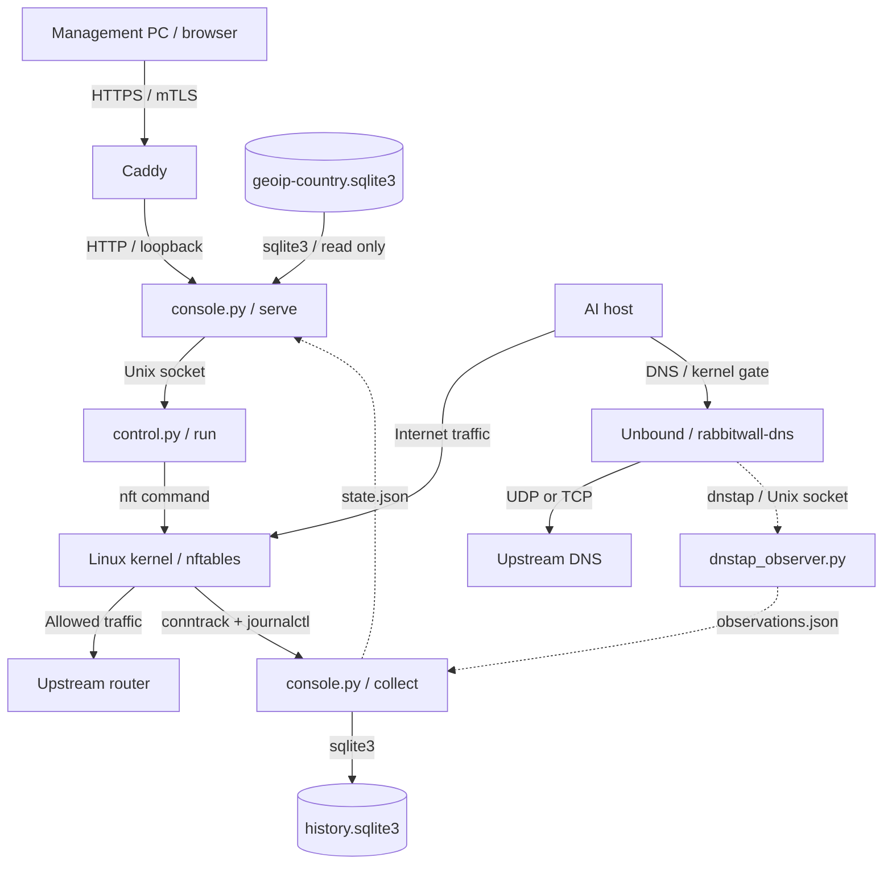
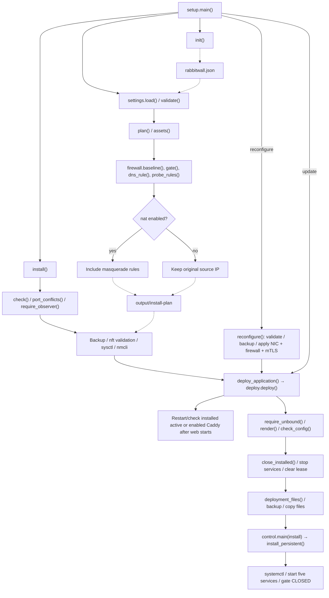
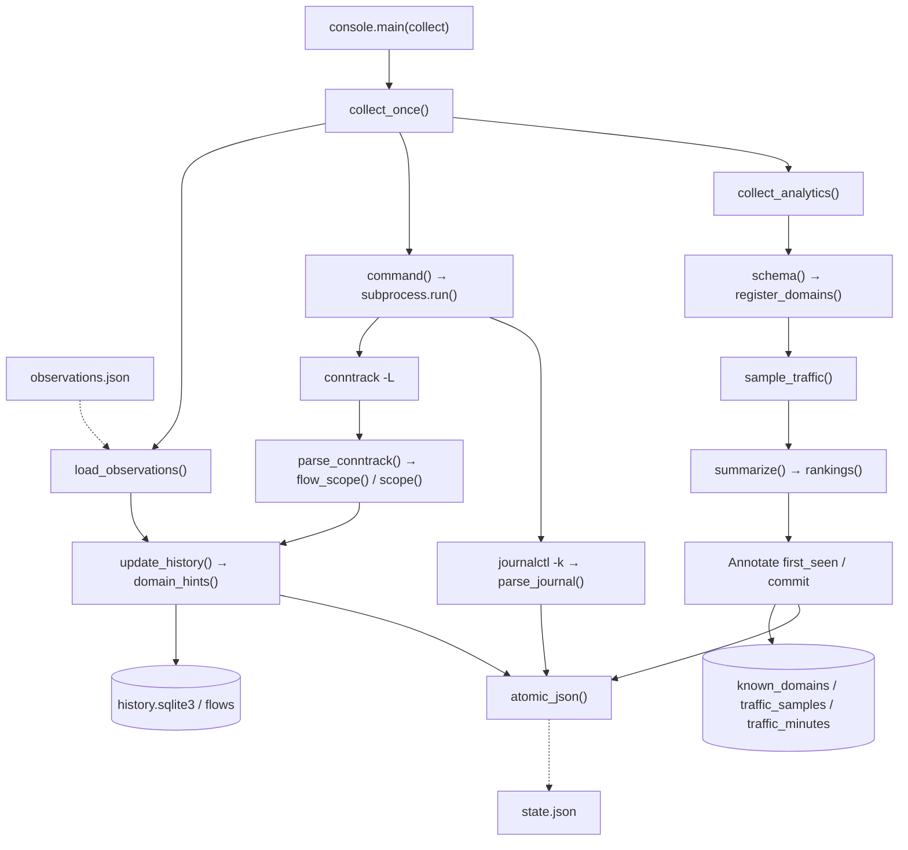
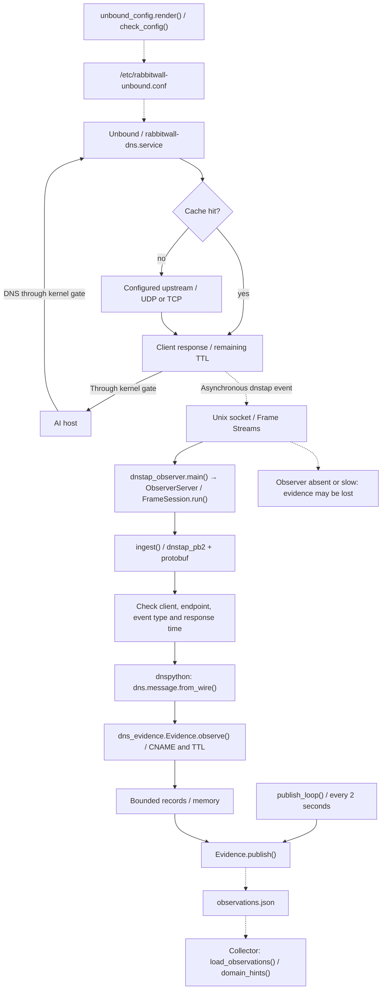
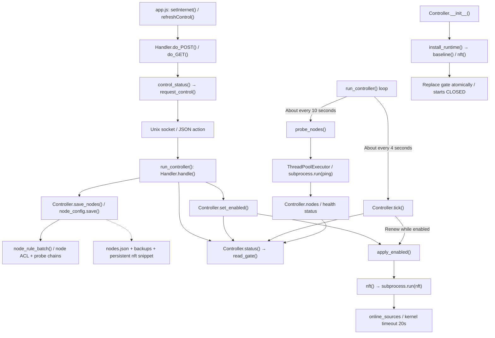
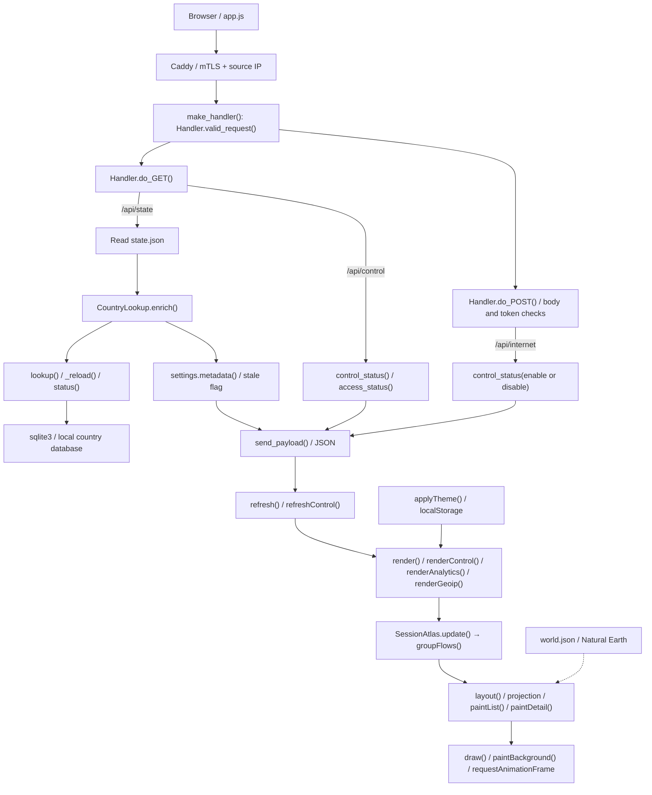
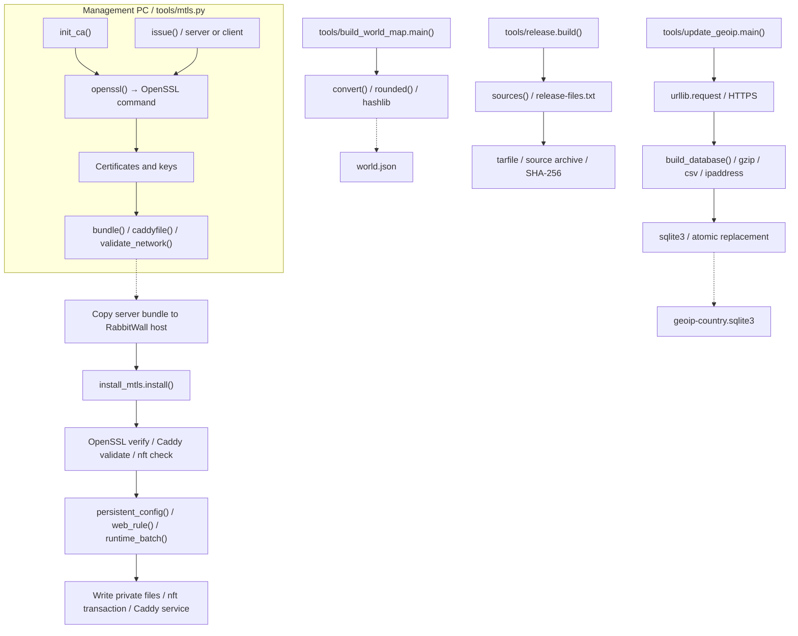

# プログラム簡易フロー

[English](PROGRAM_FLOW.md) | [日本語](PROGRAM_FLOW.ja.md)

主要な関数呼び出しとデータの流れを処理別に示します。実線は通信・呼び出し・入出力、点線はファイルを介した受け渡しです。関数名は実装に合わせています。正常系を中心に簡略化し、補助関数は末尾の索引にまとめています。図はGitHubで表示できるMermaid形式です。

外部コマンドと発行元、2種類のUnixソケットは [OSコマンド参考資料](OS_COMMANDS.ja.md) を参照してください。

## 1. 全体構成

通常のパケットはLinuxカーネルのnftablesが転送・遮断します。Pythonが全パケットを中継するわけではありません。DNSはUnboundが受け付け、Pythonは独立したdnstap観測サービスで応答のコピーを解析します。Web・収集・制御・DNS・DNS観測は別々のsystemdサービスです。

## 2. 導入・更新

入口はsetup.pyのmain()です。planは設定ファイルを生成するだけです。初回installはFW・NIC設定を変更し、updateは既存設定を維持してアプリを更新します。deploy()は旧コードで閉操作を行い、サービス停止後に残った許可も消してからファイルを更新します。

## 3. 通信収集とランキング

collect_once()の完了後、既定で約5秒待って次を収集します。収集失敗時は過去の接続を「終了」にせず、エラーをJSONへ渡します。ランキングは累積カウンターの差分です。初回は基準値の設定だけを行います。

## 4. DNS転送と推定ドメイン

DNS本体はUnboundで、上流へのUDP/TCP問い合わせ、キャッシュ、応答生成を担当します。dnstapのCLIENT_RESPONSEイベントはキャッシュ応答も含みます。観測側はProtocol Buffersでイベントを復号し、dnspythonでDNS応答を解析します。端末IP・応答IP・CNAME・残りTTLを照合し、既存の観測JSONへ渡します。

Unboundと観測サービスは起動依存を持ちません。観測停止や処理遅延時も名前解決は継続し、観測イベントが欠落することがあります。閉状態のDNS遮断は、キャッシュ応答を含めnftablesが行います。観測はDNSの転送経路に入りません。

## 5. 開閉制御と死活監視

WebはUnixソケットで固定の開閉操作と検証済みのノード設定を渡します。ノード保存は専用の管理アクセス・監視用チェーンだけを更新し、開閉ゲート・NIC・DNSを変更しません。設定のバックアップ後、`/etc/rabbitwall-nodes/nodes.json` と永続FW断片をファイル単位で原子的に保存し、書込失敗時は元のファイルと稼働ルールへの復元を試みます。監視と管理SSH・Pingの許可は独立しています。開状態は約4秒ごとに更新する20秒の許可期限で管理し、再起動・テーブル再作成・期限切れ後は自動で開き直しません。死活監視は約10秒ごとに別スレッドで実行します。

## 6. Web APIとブラウザー描画

Caddyは証明書と送信元IPを検証し、サーバー側の操作キーを付加してHost・Originをバックエンド向けに変換します。国表示はWebがJSONを読む時にローカルDBから付加します。デモではdemo_state()とメモリ上の模擬開閉状態を使います。描画・演出・配色保存にはブラウザー標準APIを使い、外部JSライブラリーは使いません。

## 7. 証明書・国データ・配布資材

以下は管理者が必要時に実行するツールです。CAとクライアントの秘密鍵は管理PCに残します。国DBはHTTPSで任意取得し、CSVをSQLiteへ変換して置換します。変換失敗時は既存DBを維持します。地図生成は入力GeoJSONの変換、配布処理は許可リストに基づく梱包です。

## 依存先との接点

| 依存先 | 用途 | 主な接点 | 区分 |
| --- | --- | --- | --- |
| dnspython | 観測DNS応答の解析 | ingest(), Evidence.observe() | External Python package |
| protobuf / dnstap_pb2 | dnstapイベントの復号（公式スキーマから生成） | ingest() | External Python package + generated binding |
| Unbound | DNS転送・キャッシュ・非同期dnstap出力 | unbound_config.render(), rabbitwall-dns.service | External DNS service |
| sqlite3 | 履歴・集計保存、国DB参照 | console, traffic_analytics, geoip, update_geoip | Python standard library |
| socket, socketserver, http.server, threading | HTTP待受、Unixソケット、同時処理制限 | dnstap_observer, console, control | Python standard library |
| subprocess, concurrent.futures | OSコマンドと監視タスク | command(), nft(), probe_nodes(), run() | Python standard library |
| urllib.request, gzip, csv, ipaddress | DB-IP取得・展開・検証 | update_geoip.main(), build_database() | Python standard library |
| nft, conntrack, journalctl, ping | FW操作・接続状態・ログ・死活監視 | control.nft(), console.command(), probe_nodes() | OS commands |
| nmcli, sysctl, modprobe, systemctl | NIC・カーネル・サービス設定 | setup.install(), deploy.deploy() | OS commands |
| OpenSSL, Caddy | 証明書生成・検証、mTLS終端 | mtls.openssl(), install_mtls.install() | External programs |
| fetch, Canvas 2D, requestAnimationFrame, localStorage | API取得・地図・演出・配色保存 | app.js, atlas.js | Browser APIs |
| Natural Earth, DB-IP Country Lite | 地図形状・IPと国の対応 | world.json, geoip-country.sqlite3 | Data |

## Python関数索引

補助関数・メソッドを含み、コンストラクターと生成コードは省略しています。公式スキーマの生成バインディングは [dnstap_pb2.py](../src/rabbitwall/dnstap_pb2.py)、出典・再生成手順は [スキーマ資料](../third_party/dnstap/README.md) を参照してください。

### [setup.py](../setup.py)

`run()`, `init()`, `assets()`, `plan()`, `port_conflicts()`, `check()`, `mtls_assets()`, `reconfigure()`, `install()`, `deploy_application()`, `doctor()`, `main()`

### [src/rabbitwall/console.py](../src/rabbitwall/console.py)

`utc_now()`, `scope()`, `flow_scope()`, `parse_conntrack()`, `parse_journal()`, `command()`, `update_history()`, `atomic_json()`, `collect_once()`, `demo_state()`, `ConsoleServer.__init__()`, `ConsoleServer.get_request()`, `ConsoleServer.process_request()`, `ConsoleServer.process_request_thread()`, `make_handler()`, `make_handler.control_status()`, `make_handler.nodes_status()`, `make_handler.Handler.log_message()`, `make_handler.Handler.valid_token()`, `make_handler.Handler.access_status()`, `make_handler.Handler.valid_request()`, `make_handler.Handler.send_payload()`, `make_handler.Handler.do_POST()`, `make_handler.Handler.do_GET()`, `main()`

### [src/rabbitwall/control.py](../src/rabbitwall/control.py)

`utc_now()`, `nft()`, `request_control()`, `read_gate()`, `baseline()`, `install_runtime()`, `apply_enabled()`, `probe_nodes()`, `Controller.__init__()`, `Controller.status()`, `Controller.node_settings()`, `Controller.save_nodes()`, `Controller.set_enabled()`, `Controller.tick()`, `run_controller()`, `run_controller.stop()`, `run_controller.Handler.handle()`, `install_persistent()`, `main()`

### [src/rabbitwall/dependencies.py](../src/rabbitwall/dependencies.py)

`check_dns_version()`, `require_dns()`, `require_observer()`

### [src/rabbitwall/dns_evidence.py](../src/rabbitwall/dns_evidence.py)

`Evidence.observe()`, `Evidence.publish()`

### [src/rabbitwall/dns_observations.py](../src/rabbitwall/dns_observations.py)

`load_observations()`, `domain_hints()`

### [src/rabbitwall/dnstap_observer.py](../src/rabbitwall/dnstap_observer.py)

`control_frame()`, `parse_control()`, `ingest()`, `FrameSession.read_exact()`, `FrameSession.run()`, `ObserverServer.handle_error()`, `ObserverHandler.handle()`, `publish_loop()`, `main()`

### [src/rabbitwall/firewall.py](../src/rabbitwall/firewall.py)

`dns_rule()`, `node_rule_batch()`, `probe_rules()`, `gate()`, `baseline()`

### [src/rabbitwall/geoip.py](../src/rabbitwall/geoip.py)

`CountryLookup._reload()`, `CountryLookup.status()`, `CountryLookup.lookup()`, `CountryLookup.enrich()`

### [src/rabbitwall/node_config.py](../src/rabbitwall/node_config.py)

`revision()`, `document()`, `candidate()`, `atomic_write()`, `save()`

### [src/rabbitwall/settings.py](../src/rabbitwall/settings.py)

`interface()`, `validate()`, `validate.usable()`, `load()`, `monitored()`, `management_allowed()`, `metadata()`, `require_config()`

### [src/rabbitwall/traffic_analytics.py](../src/rabbitwall/traffic_analytics.py)

`schema()`, `public_ai()`, `names_of()`, `counter()`, `register_domains()`, `sample_traffic()`, `rankings()`, `rankings.serialize()`, `summarize()`, `collect_analytics()`

### [src/rabbitwall/unbound_config.py](../src/rabbitwall/unbound_config.py)

`render()`, `require_unbound()`, `check_config()`

### [tools/build_world_map.py](../tools/build_world_map.py)

`rounded()`, `convert()`, `main()`

### [tools/deploy.py](../tools/deploy.py)

`run()`, `close_installed()`, `deployment_files()`, `deploy()`

### [tools/install_mtls.py](../tools/install_mtls.py)

`run()`, `persistent_config()`, `web_rule()`, `runtime_batch()`, `install()`

### [tools/mtls.py](../tools/mtls.py)

`configure()`, `openssl()`, `new_directory()`, `write()`, `password_args()`, `valid_name()`, `init_ca()`, `issue()`, `validate_network()`, `caddyfile()`, `bundle()`, `main()`

### [tools/release.py](../tools/release.py)

`sources()`, `build()`

### [tools/update_geoip.py](../tools/update_geoip.py)

`build_database()`, `main()`

## ブラウザー側の関数索引

名前付き関数・SessionAtlasのメソッドを示します。コンストラクターと匿名イベントハンドラーは省略しています。

### [src/rabbitwall/static/app.js](../src/rabbitwall/static/app.js)

`setSessionView()`, `resetAtlasView()`, `countryText()`, `direction()`, `navigate()`, `renderGeoip()`, `endpoint()`, `clock()`, `bytes()`, `cell()`, `renderControl()`, `refreshControl()`, `setInternet()`, `render()`, `newDomainBadge()`, `timestampText()`, `renderAnalytics()`, `refresh()`, `applyTheme()`

### [src/rabbitwall/static/atlas.js](../src/rabbitwall/static/atlas.js)

`endpointNode()`, `routeColor()`, `groupFlows()`, `quadratic()`, `hash()`, `wrapLongitude()`, `projection()`, `unwrapRing()`, `pacificInset()`, `toggledSelection()`, `SessionAtlas.color()`, `SessionAtlas.setTheme()`, `SessionAtlas.resetPosition()`, `SessionAtlas.wheelZoom()`, `SessionAtlas.startPan()`, `SessionAtlas.movePan()`, `SessionAtlas.endPan()`, `SessionAtlas.setActive()`, `SessionAtlas.setPaused()`, `SessionAtlas.update()`, `SessionAtlas.paintSummary()`, `SessionAtlas.paintList()`, `SessionAtlas.select()`, `SessionAtlas.clearSelection()`, `SessionAtlas.paintDetail()`, `SessionAtlas.resize()`, `SessionAtlas.project()`, `SessionAtlas.layout()`, `SessionAtlas.paintBackground()`, `SessionAtlas.draw()`, `SessionAtlas.schedule()`, `SessionAtlas.pick()`

実際の導入は[導入ガイド](INSTALL.ja.md)、保存期間や画面操作は[運用ガイド](OPERATIONS.ja.md)を参照してください。
