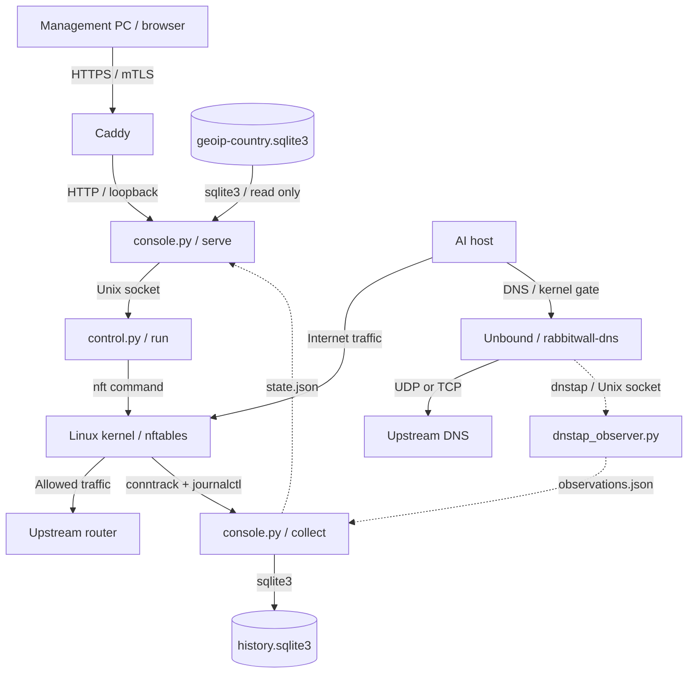
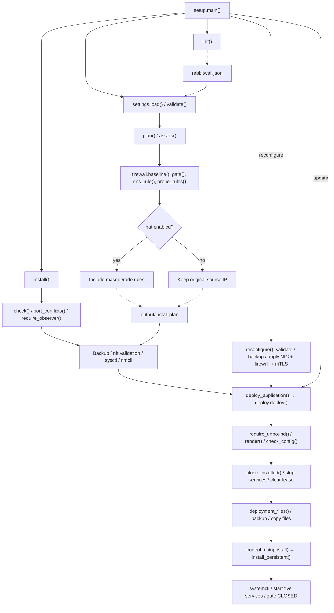
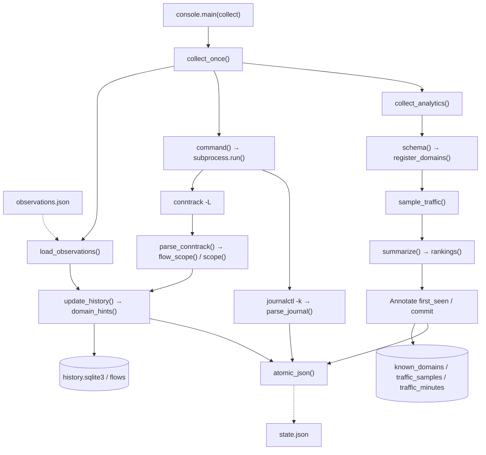
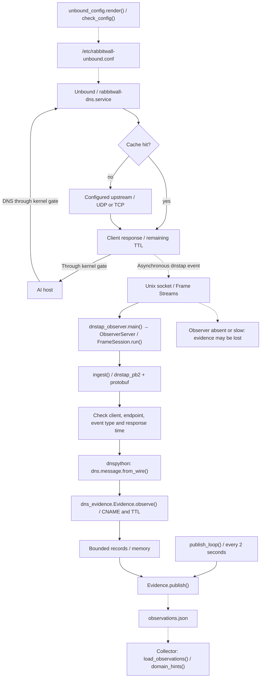
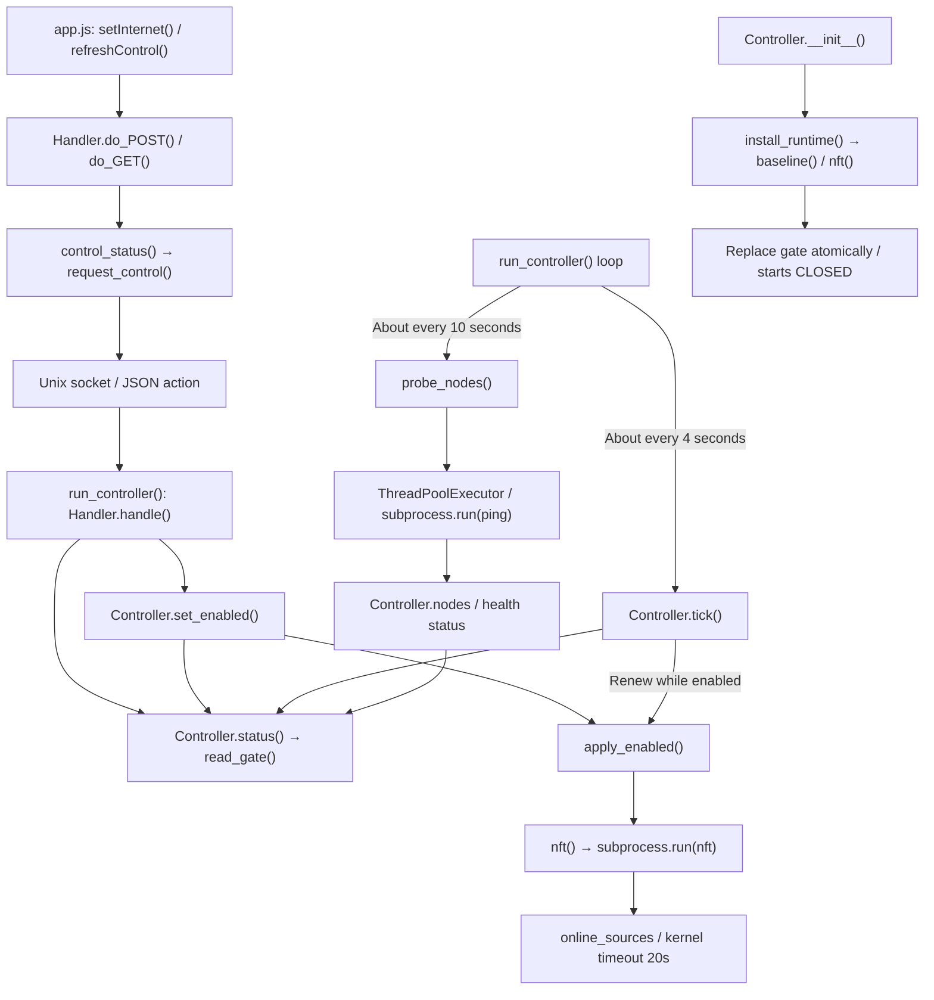
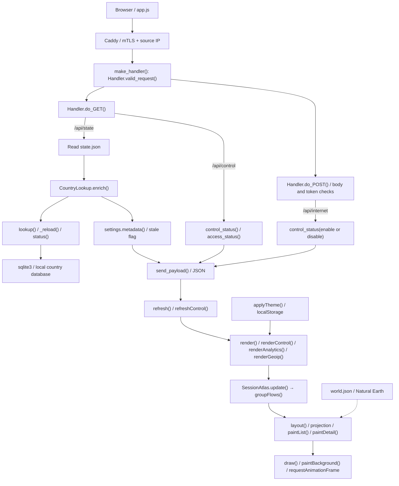
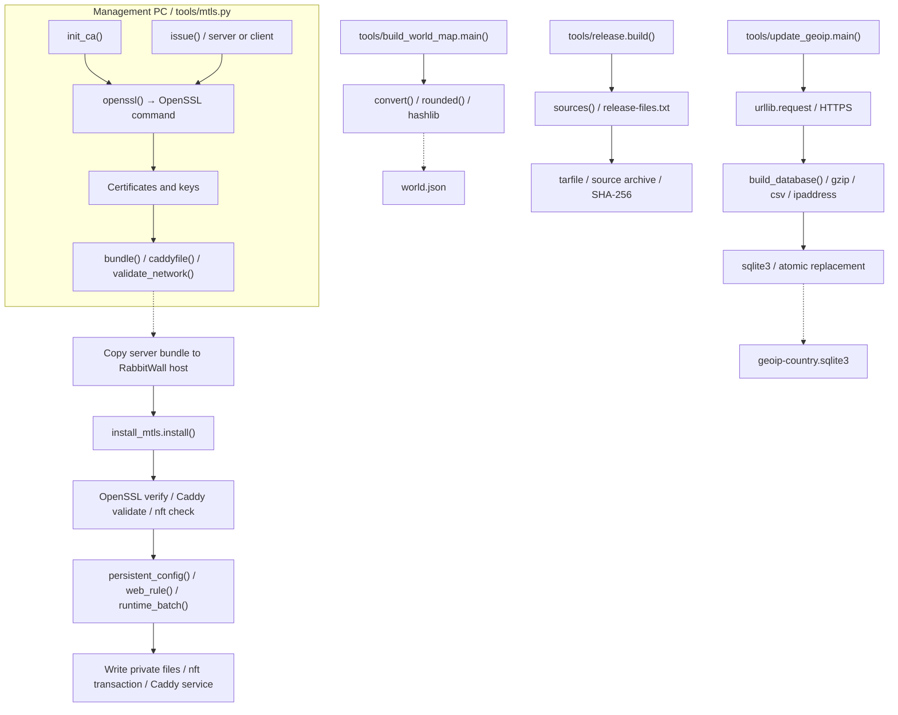

# Program flow overview

[English](PROGRAM_FLOW.md) | [日本語](PROGRAM_FLOW.ja.md)

These diagrams group the main function calls and data paths by responsibility. Solid arrows indicate requests, calls or I/O; dotted arrows indicate file handoffs. Function names match the implementation. Main successful paths are simplified; helpers appear in the index below. Diagrams use GitHub-compatible Mermaid syntax.

## 1. Runtime overview

Linux kernel nftables rules forward or block normal traffic; Python does not relay every packet. Unbound handles DNS, while an independent Python dnstap observer parses copies of responses. Web, collection, control, DNS and DNS observation run as separate systemd services.

## 2. Installation and updates

The entry point is setup.main(). plan only generates configuration files. Initial install changes firewall and NIC settings; update preserves installed settings while deploying the application. deploy() closes the gate using old code, stops services and clears any remaining permission before replacing files.

## 3. Collection and rankings

After collect_once() finishes, the collector waits about five seconds by default. Failure does not mark previous connections ended; errors are included in JSON. Rankings use cumulative-counter deltas, with the first observation establishing a baseline.

## 4. DNS forwarding and domain evidence

Unbound owns upstream UDP/TCP queries, caching and DNS responses. CLIENT_RESPONSE dnstap events include cached replies. The observer decodes events with Protocol Buffers and parses DNS responses with dnspython. It matches client IP, answer IP, CNAME and remaining TTL, then publishes the existing observation JSON format.

Unbound and the observer have no startup dependency on each other. DNS continues when observation stops or falls behind, at the cost of lost events. nftables blocks closed-gate DNS, including cache replies. The observer is outside the DNS forwarding path.

## 5. Gate control and node health

The web service sends only fixed status, enable and disable actions over a Unix socket. The controller invokes nft. While open, a 20-second permission lease is renewed about every four seconds. Restart, table recreation or lease expiry does not automatically restore access. Health probes run about every ten seconds in a separate thread.

## 6. Web API and browser rendering

Caddy checks client certificates and source IP, injects the server-side operation key, and rewrites Host and Origin for the backend. Country labels are added from a local DB when the web service reads JSON. Demo mode uses demo_state() and an in-memory simulated gate. Rendering, animation and theme storage use browser APIs without external JavaScript libraries.

## 7. Certificates, country data and release assets

These tools run on demand. CA and client private keys stay on the management PC. Country data is an optional HTTPS download, converted from CSV into SQLite and atomically replaced; conversion failure preserves the old DB. The map builder converts input GeoJSON, while release packaging uses a file allowlist.

## Dependency boundaries

| Dependency | Purpose | Main integration points | Type |
| --- | --- | --- | --- |
| dnspython | Observed DNS response parsing | ingest(), Evidence.observe() | External Python package |
| protobuf / dnstap_pb2 | Decode dnstap events using the official schema | ingest() | External Python package + generated binding |
| Unbound | DNS forwarding, caching and asynchronous dnstap output | unbound_config.render(), rabbitwall-dns.service | External DNS service |
| sqlite3 | History, analytics and country DB | console, traffic_analytics, geoip, update_geoip | Python standard library |
| socket, socketserver, http.server, threading | HTTP listeners, Unix sockets and concurrency limits | dnstap_observer, console, control | Python standard library |
| subprocess, concurrent.futures | OS commands and probe worker | command(), nft(), probe_nodes(), run() | Python standard library |
| urllib.request, gzip, csv, ipaddress | DB-IP download, decompression and validation | update_geoip.main(), build_database() | Python standard library |
| nft, conntrack, journalctl, ping | Firewall, connections, logs and health | control.nft(), console.command(), probe_nodes() | OS commands |
| nmcli, sysctl, modprobe, systemctl | NIC, kernel and service setup | setup.install(), deploy.deploy() | OS commands |
| OpenSSL, Caddy | Certificate generation, verification and mTLS | mtls.openssl(), install_mtls.install() | External programs |
| fetch, Canvas 2D, requestAnimationFrame, localStorage | API requests, map, animation and theme storage | app.js, atlas.js | Browser APIs |
| Natural Earth, DB-IP Country Lite | Map geometry and IP-country mapping | world.json, geoip-country.sqlite3 | Data |

## Python function index

Helpers and methods are included; constructors and generated code are omitted. See [dnstap_pb2.py](../src/rabbitwall/dnstap_pb2.py) for the official schema binding and [schema notes](../third_party/dnstap/README.md) for provenance and regeneration.

### [setup.py](../setup.py)

`run()`, `init()`, `assets()`, `plan()`, `port_conflicts()`, `check()`, `mtls_assets()`, `reconfigure()`, `install()`, `deploy_application()`, `doctor()`, `main()`

### [src/rabbitwall/console.py](../src/rabbitwall/console.py)

`utc_now()`, `scope()`, `flow_scope()`, `parse_conntrack()`, `parse_conntrack.number()`, `parse_journal()`, `command()`, `update_history()`, `atomic_json()`, `collect_once()`, `demo_state()`, `ConsoleServer.get_request()`, `ConsoleServer.process_request()`, `ConsoleServer.process_request_thread()`, `make_handler()`, `make_handler.control_status()`, `make_handler.Handler.log_message()`, `make_handler.Handler.valid_token()`, `make_handler.Handler.access_status()`, `make_handler.Handler.valid_request()`, `make_handler.Handler.send_payload()`, `make_handler.Handler.do_POST()`, `make_handler.Handler.do_GET()`, `main()`, `main.stop()`

### [src/rabbitwall/control.py](../src/rabbitwall/control.py)

`utc_now()`, `nft()`, `request_control()`, `read_gate()`, `baseline()`, `install_runtime()`, `apply_enabled()`, `probe_nodes()`, `Controller.status()`, `Controller.set_enabled()`, `Controller.tick()`, `run_controller()`, `run_controller.stop()`, `run_controller.Handler.handle()`, `install_persistent()`, `main()`

### [src/rabbitwall/dependencies.py](../src/rabbitwall/dependencies.py)

`check_dns_version()`, `require_dns()`, `require_observer()`

### [src/rabbitwall/dns_evidence.py](../src/rabbitwall/dns_evidence.py)

`Evidence.observe()`, `Evidence.publish()`

### [src/rabbitwall/dns_observations.py](../src/rabbitwall/dns_observations.py)

`load_observations()`, `domain_hints()`

### [src/rabbitwall/dnstap_observer.py](../src/rabbitwall/dnstap_observer.py)

`control_frame()`, `parse_control()`, `ingest()`, `FrameSession.read_exact()`, `FrameSession.run()`, `ObserverServer.handle_error()`, `ObserverHandler.handle()`, `publish_loop()`, `main()`

### [src/rabbitwall/firewall.py](../src/rabbitwall/firewall.py)

`dns_rule()`, `probe_rules()`, `gate()`, `baseline()`

### [src/rabbitwall/geoip.py](../src/rabbitwall/geoip.py)

`CountryLookup._reload()`, `CountryLookup.status()`, `CountryLookup.lookup()`, `CountryLookup.enrich()`

### [src/rabbitwall/settings.py](../src/rabbitwall/settings.py)

`interface()`, `validate()`, `validate.usable()`, `load()`, `metadata()`, `require_config()`

### [src/rabbitwall/traffic_analytics.py](../src/rabbitwall/traffic_analytics.py)

`schema()`, `public_ai()`, `names_of()`, `counter()`, `register_domains()`, `sample_traffic()`, `rankings()`, `rankings.serialize()`, `summarize()`, `collect_analytics()`

### [src/rabbitwall/unbound_config.py](../src/rabbitwall/unbound_config.py)

`render()`, `require_unbound()`, `check_config()`

### [tools/build_world_map.py](../tools/build_world_map.py)

`rounded()`, `convert()`, `main()`

### [tools/deploy.py](../tools/deploy.py)

`run()`, `close_installed()`, `deployment_files()`, `deploy()`

### [tools/install_mtls.py](../tools/install_mtls.py)

`run()`, `persistent_config()`, `web_rule()`, `runtime_batch()`, `install()`

### [tools/mtls.py](../tools/mtls.py)

`configure()`, `openssl()`, `new_directory()`, `write()`, `password_args()`, `valid_name()`, `init_ca()`, `issue()`, `validate_network()`, `caddyfile()`, `bundle()`, `main()`

### [tools/release.py](../tools/release.py)

`sources()`, `build()`

### [tools/update_geoip.py](../tools/update_geoip.py)

`build_database()`, `main()`

## Browser function index

Named functions and SessionAtlas methods are listed below. Constructors and anonymous event handlers are omitted.

### [src/rabbitwall/static/app.js](../src/rabbitwall/static/app.js)

`setSessionView()`, `resetAtlasView()`, `countryText()`, `direction()`, `navigate()`, `renderGeoip()`, `endpoint()`, `clock()`, `bytes()`, `cell()`, `renderControl()`, `refreshControl()`, `setInternet()`, `render()`, `newDomainBadge()`, `timestampText()`, `renderAnalytics()`, `refresh()`, `applyTheme()`

### [src/rabbitwall/static/atlas.js](../src/rabbitwall/static/atlas.js)

`endpointNode()`, `routeColor()`, `groupFlows()`, `quadratic()`, `hash()`, `wrapLongitude()`, `projection()`, `unwrapRing()`, `pacificInset()`, `toggledSelection()`, `SessionAtlas.color()`, `SessionAtlas.setTheme()`, `SessionAtlas.resetPosition()`, `SessionAtlas.wheelZoom()`, `SessionAtlas.startPan()`, `SessionAtlas.movePan()`, `SessionAtlas.endPan()`, `SessionAtlas.setActive()`, `SessionAtlas.setPaused()`, `SessionAtlas.update()`, `SessionAtlas.paintSummary()`, `SessionAtlas.paintList()`, `SessionAtlas.select()`, `SessionAtlas.clearSelection()`, `SessionAtlas.paintDetail()`, `SessionAtlas.resize()`, `SessionAtlas.project()`, `SessionAtlas.layout()`, `SessionAtlas.paintBackground()`, `SessionAtlas.draw()`, `SessionAtlas.schedule()`, `SessionAtlas.pick()`

See the [installation guide](INSTALL.md) for deployment and the [operations guide](OPERATIONS.md) for retention and console usage.
